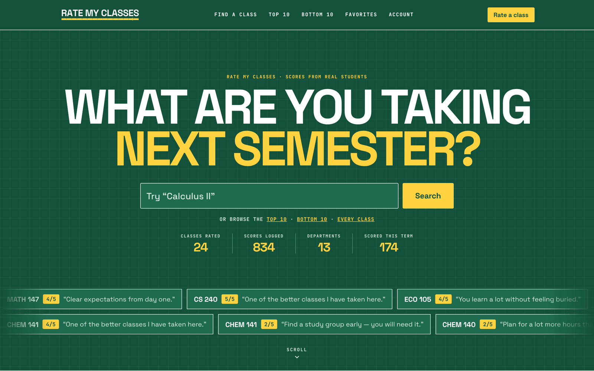
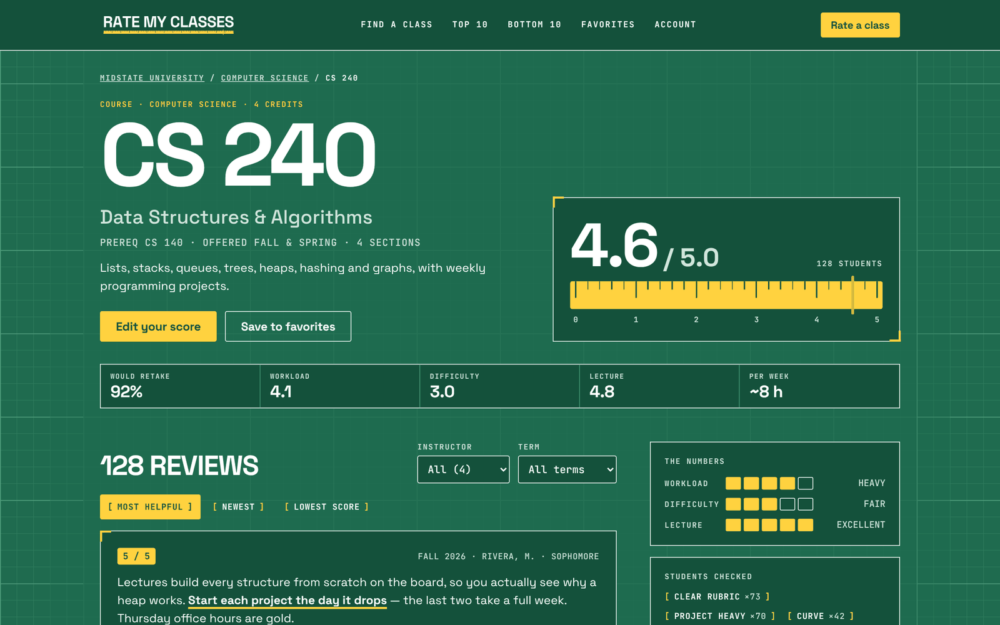
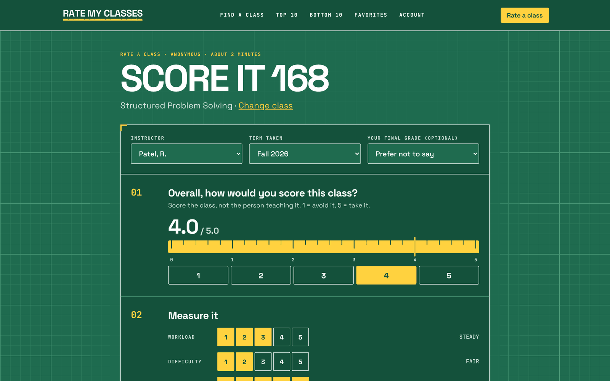
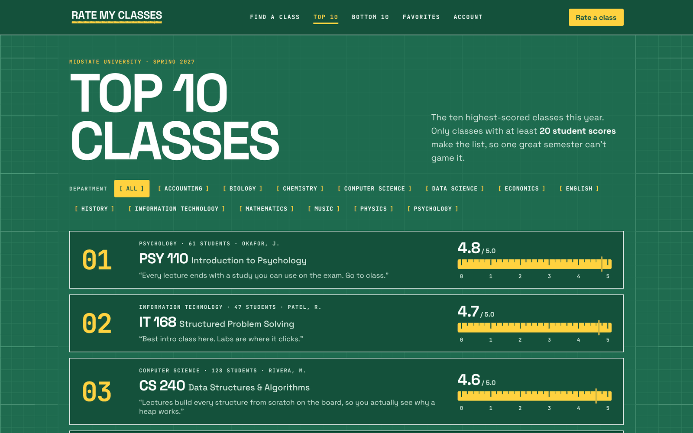
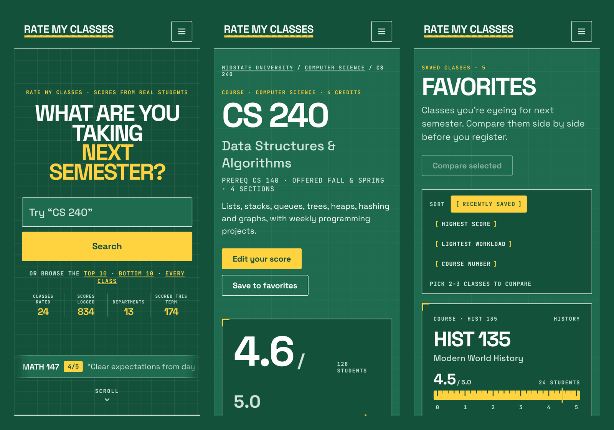

<div align="center">

<picture>
  <source media="(prefers-color-scheme: dark)" srcset="docs/images/logo-dark.svg">
  
</picture>

### Measure twice. Enroll once.

**Rate My Classes** lets students score and review the *classes* they've taken (not the professors), so the next student can pick a semester that won't eat them alive.

An IT 326 class project by **Segfault Society**.


[Quick start](#quick-start) · [Features](#features) · [Tech stack](#tech-stack) · [Team](#team) · [Developer guide](docs/DEVELOPMENT.md)

</div>

<br>



## Why

Registration is a guess. Most rating sites score *professors*, but what you actually want to know is what the **class** is like: how heavy the workload is, how hard the exams are, and whether people would take it again.

Rate My Classes measures each class like a ruler:

- **One score, 0–5.** It's shown with a single decimal, like `4.6 / 5.0`.
- **Three meters.** Workload, difficulty and lecture quality, each rated 1–5.
- **Honest by design.** Reviews are anonymous. A score only appears once **5 students** have rated a class, and the Top 10 and Bottom 10 only count classes with **20+ scores**.

## Features

| | |
|---|---|
| 🔎 **Find a class** | Search by course number, title, instructor or department, with instant suggestions as you type. |
| 📏 **Class pages** | The score ruler, workload / difficulty / lecture meters, "would take again" percentage, and reviews you can filter by instructor and term. |
| ✍️ **Rate a class** | A two-minute, five-step review: overall score, the three meters, tags like *Clear rubric* or *Curve*, a written review, and "would you take it again?" |
| 🏆 **Top 10 / Bottom 10** | The best- and worst-scored classes. Each Bottom 10 class comes with a "what helps" tip from students who passed. |
| ⭐ **Favorites** | Save classes you're eyeing, then compare two or three side by side before registration. |
| ⚖️ **Weigh your semester** | Stack up to six classes and see roughly how many hours a week they'll cost. |
| 🎲 **Light-load roulette** | A random well-rated class with a light workload, for when you need a gen-ed. |
| ➕ **Add a class** | Students can add a missing class. The form checks for similar classes already listed. |
| 👤 **Accounts** | School-email sign-up, your reviews (edit or delete), profile, notifications and privacy settings. |

<table>
  <tr>
    <td width="50%"><br><sub><b>Class page:</b> score ruler, meters and reviews</sub></td>
    <td width="50%"><br><sub><b>Rate a class:</b> the five-step review</sub></td>
  </tr>
  <tr>
    <td width="50%"><br><sub><b>Top 10:</b> classes with 20+ scores only</sub></td>
    <td width="50%"><br><sub><b>On a phone:</b> every page is responsive</sub></td>
  </tr>
</table>

## Tech stack

| Layer | What we use |
|---|---|
| **Frontend** | React 19 (JSX), Vite 8 (dev server and build; proxies `/api` to the backend), oxlint |
| **Backend** | Python 3.14 managed by [uv](https://docs.astral.sh/uv/), FastAPI (docs at `/docs`), SQLModel, Uvicorn |
| **Database** | PostgreSQL on [Neon](https://neon.tech). Each developer works on their own branch, and every pull request gets a temporary preview branch through GitHub Actions. |

```
Browser ──► Vite (React)  :5173 ──/api──►  FastAPI  :2626 ──►  Neon PostgreSQL
```

## Quick start

You need [uv](https://docs.astral.sh/uv/getting-started/installation/), [Node.js 20+](https://nodejs.org) and [Git](https://git-scm.com). uv installs Python for you.

```bash
git clone https://github.com/createdbyct/IT326_Segfault-Society_ClassProject.git
cd IT326_Segfault-Society_ClassProject
```

| | macOS / Linux | Windows (PowerShell) |
|---|---|---|
| **1. Set up** (once) | `./setup.sh` | `.\setup.ps1` |
| **2. Run** | `./dev.sh` | `.\dev.ps1` |

Setup asks for your Neon `DATABASE_URL`: in Neon, open the project, click **Connect**, and copy the string for your branch. Then open:

- **App:** http://localhost:5173
- **API docs:** http://127.0.0.1:2626/docs

> [!NOTE]
> These are shell scripts, so run them as `./dev.sh` (or `bash dev.sh`), not with `python`.
> If a script won't run on macOS / Linux, run `chmod +x setup.sh dev.sh` once.

For everything else (adding tables, packages, resetting your database branch, troubleshooting), see the **[developer guide](docs/DEVELOPMENT.md)**.

## Project structure

```
backend/                FastAPI + SQLModel API (port 2626)
  src/main.py           routes
  src/models/           database tables
  init_db.py            create tables · reset_db.py  drop + recreate
frontend/               React + Vite app (port 5173)
.github/workflows/      Neon preview branch per pull request
setup.sh / setup.ps1    one-time setup
dev.sh / dev.ps1        start backend + frontend together
docs/                   developer guide and README images
```

## Project status

- [x] Brand and design system (the "Cutting Mat" look: green grid, ruler yellow, bold white)
- [x] Page designs for every screen
- [x] Dev environment: uv, Vite proxy, setup and run scripts
- [x] Neon database with per-developer and per-PR branches
- [x] Users table and endpoints
- [ ] Classes, reviews and favorites tables and endpoints
- [ ] Frontend pages connected to the API
- [ ] Deployment

## Team

**Segfault Society**, IT 326.

| | |
|---|---|
| **Sam Mate** | Project Manager · Grad Student |
| **Brij Kamleshbhai Patel** | Grad Student |
| **Christian Taylor** | |
| **Hayden Pyles** | |
| **Karsten Tisdale** | |

## Contributing (team)

1. Branch off `main`: `git checkout -b dev-yourname`.
2. Commit small, clear changes. Commit `uv.lock` and `package-lock.json` when dependencies change.
3. Open a pull request. A temporary Neon database branch is created for it automatically and deleted when the PR closes.
4. Never commit `backend/.env`. It holds the database password and is already in `.gitignore`.

---

<sub>Rate My Classes is a student project for IT 326. It is not affiliated with any university. Class names, scores and reviews in screenshots are sample data.</sub>
